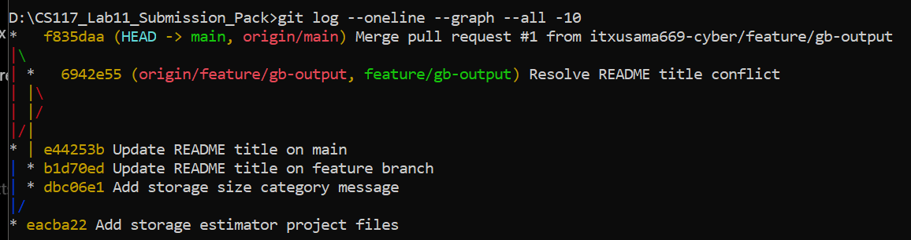
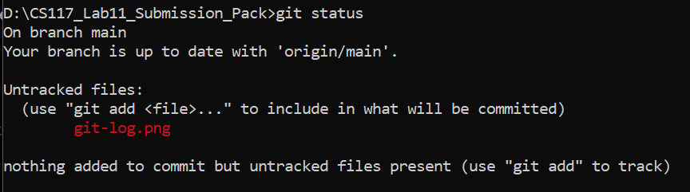

# CS-117 Lab 11 — Individual Evidence Sheet

- Repository name: Muhammad Usama

- Remote URL: https://github.com/itxusama669-cyber/CS117-Lab11-Storage-Estimator

- First commit short hash and message: eacba22 Add storage estimator project files

- Status interpretation:The `git status` command showed that I was on the `main` branch and that it was up to date
 with `origin/main`. It also showed `git-log.png` and `git-status.png` as untracked files, meaning Git had detected
 the screenshots, but they had not yet been added to version control.

- Diff inspected: The `git show dbc06e1 -- storage_estimator.py` command displayed the changes made in my feature
 commit. I added an `if-elif-else` structure to display a message when the input size is smaller than, exactly
 equal to, or larger than 1024 MB (1 GB). The existing MB-to-GB conversion was retained.

- Feature branch: feature/gb-output

- Issue:
  Issue number: 2
  Issue title: Add storage size category message
  Issue Link: https://github.com/itxusama669-cyber/CS117-Lab11-Storage-Estimator/issues/2

- Pull Request:
  Pull Request number: 1
  Pull Request title: Add storage size category message
  Pull Request URL: https://github.com/itxusama669-cyber/CS117-Lab11-Storage-Estimator/pull/1
  Pull Request Status: Merged

- Specific review comment: "good critical thinking used hats off"

- Conflict diagnosis: File with conflict: README.md
  Cause of conflict: The README heading was changed differently on the main and feature/gb-output branches.
  Command used: git merge main
  Git result: Git reported a content conflict in README.md and stopped the automatic merge.

- Conflict resolution: Resolution: I opened README.md, removed the conflict markers, and kept one final heading: # Storage Estimator.
  Commands used to finish the resolution:
  git add README.md
  git commit -m "Resolve README title conflict"
  git push origin feature/gb-output
  Final result: The conflict-resolution commit was pushed to GitHub, and the Pull Request was merged into main.

- Exit task / instructor initials: [complete with instructor during lab]

## Evidence screenshots

### Git commit history

### Git status

## Viva preparation
1. **Git vs GitHub:** Git is version-control software; GitHub hosts repositories online and supports collaboration.
2. **Working tree:** The files currently in your project folder.
3. **Staging area:** The changes selected for the next commit.
4. **Commit:** A saved snapshot in local Git history.
5. **Push vs pull:** Push sends local commits to a remote; pull brings remote changes into the current branch.
6. **Branch:** A separate line of development.
7. **Pull Request:** A proposal to review and merge changes from one branch into another.
8. **Merge conflict:** Git cannot automatically combine competing edits, so a person must choose the final content.
